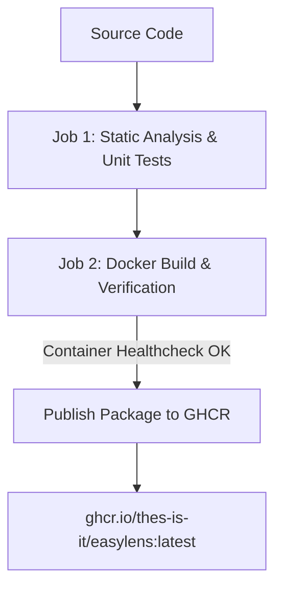

# EasyLens Docker & Containerization Guide

This document explains how the EasyLens container image is built, tested, and published automatically as a Docker package to the GitHub Container Registry (GHCR).

---

### 01 — ARCHITECTURE OVERVIEW

The container setup uses an NGINX production server:



#### Key Components

- `Dockerfile`: NGINX container serving the application portal (`nginx:1.25-alpine`).
- `nginx.conf`: NGINX server configuration with Gzip compression and asset caching headers.
- `docker-compose.yml`: Local container orchestration.
- `.dockerignore`: Excludes build caches, native OS folders, and large binary models (`model.bin`).

---

### 02 — QUICK START: RUNNING LOCALLY WITH DOCKER

#### Prerequisites

> - `Docker Desktop` installed and running.

#### Using Docker Compose (Recommended)

##### Standard Local Launch
To build and launch the containerized application in detached mode:

```bash
docker compose up --build -d
```

Once started, navigate to:
`http://localhost:8080`

To stop the container:
```bash
docker compose down
```

---

### 02.1 — FRESH INSTALLATION & VERIFICATION PROTOCOL

To verify a clean deployment from an uninitialized environment without pre-existing container state:

1. **Step 1: Verify Clean Environment (Nothing Running)**
   Ensure no previous instance or port conflict exists:
   ```bash
   docker compose down
   docker ps | grep easylens
   ```
   *(Expected output: No EasyLens container running)*

2. **Step 2: Build & Start Container from Scratch**
   ```bash
   docker compose up --build -d
   ```
   *(This builds the NGINX image and launches `easylens_mobile_server` on port 8080)*

3. **Step 3: Verify Status & Health Check**
   ```bash
   docker compose ps
   curl -I http://localhost:8080/
   ```
   *(Expected output: Status `Up (healthy)`, HTTP `200 OK`)*

4. **Step 4: Demo the Web Portal**
   Open your browser to:
   **`http://localhost:8080`**
   Showcase the live EasyLens Web Portal, APK download link, responsive layout, and headers.

5. **Step 5: Clean Teardown**
   When the demo is concluded, cleanly stop and remove the container:
   ```bash
   docker compose down
   ```

---

#### Using Docker CLI Manually

##### Build the Docker Image
```bash
docker build -t easylens:latest .
```

##### Run the Container
```bash
docker run -d \
  --name easylens_app \
  -p 8080:80 \
  --restart always \
  easylens:latest
```

##### Test Container Health
```bash
curl -f http://localhost:8080/
```

---

### 03 — PULLING PRE-BUILT PACKAGE IMAGE FROM GITHUB PACKAGES (GHCR)

On every push to the `main` branch, GitHub Actions compiles and publishes the official Docker package image directly to GitHub Container Registry (GHCR). You can pull and run the package without building locally:

```bash
# Pull the latest Docker package
docker pull ghcr.io/thes-is-it/easylens:latest

# Run the containerized app
docker run -d \
  --name easylens_live \
  -p 8080:80 \
  --restart always \
  ghcr.io/thes-is-it/easylens:latest
```

---

### 04 — ARCHITECTURAL COMPONENT BREAKDOWN & ROLES

The following table distinguishes each component across the source code, packaging, and runtime layers:

| Component Label | Type | Purpose | Primary Command |
|---|---|---|---|
| **Git Repository** | Source Control | Stores raw, editable code files (`.dart`, `.html`, `.conf`), version history, and configurations. | `git clone https://github.com/Thes-IS-IT/Easylens.git` |
| **Container Image** | Packaged Appliance | An immutable, multi-architecture Linux snapshot bundling NGINX, web assets, and health checks. | `docker pull ghcr.io/thes-is-it/easylens:latest` |
| **Container Instance** | Runtime Process | Active execution instance of the Docker image running on host port `8080`. | `docker run -d -p 8080:80 ghcr.io/thes-is-it/easylens:latest` |
| **Web Portal Gateway** | Distribution UI | Interactive landing interface serving Buddy assets, APK downloads, and iOS installation guides. | Access at `http://localhost:8080` |
| **Asset Extraction** | Container Utility | Copies assets or build outputs directly from inside a container to the host machine without Git. | `docker cp <container_name>:<path_inside> <host_path>` |

#### Conceptual Difference: `git clone` vs `docker pull`

- **`git clone` (Source Code Repository):**  
  Downloads individual source files, documentation, and Git branches to your local machine for editing, code development, and manual compilation.
- **`docker pull` (Pre-Packaged Appliance):**  
  Downloads a self-contained, pre-compiled application appliance from GitHub Container Registry (GHCR). It does not download individual repository files to your folder; rather, the web portal and its dependencies run inside Docker's isolated runtime engine.

---

### 05 — EXTRACTING FILES FROM CONTAINER (`docker cp`)

If you need to retrieve files or assets directly from a container to your host machine without cloning the Git repository:

```bash
# 1. Start the container
docker run -d --name easylens_extract -p 8080:80 ghcr.io/thes-is-it/easylens:latest

# 2. Copy the index.html or assets to your local directory
docker cp easylens_extract:/usr/share/nginx/html/index.html ./index.html
docker cp easylens_extract:/usr/share/nginx/html/app_logo.png ./app_logo.png

# 3. Clean up the container
docker stop easylens_extract && docker rm easylens_extract
```

---

### 06 — AUTOMATED CI/CD WORKFLOW (`.github/workflows/ci_cd.yml`)

1. **`analyze_and_test`**:
   - Runs static code analysis (`flutter analyze --no-fatal-warnings --no-fatal-infos`).
   - Executes all unit tests (`flutter test`).
2. **`docker_build_and_publish`**:
   - Builds multi-architecture Docker images (`linux/amd64`, `linux/arm64`) using QEMU and Buildx.
   - Verifies container health (`curl http://localhost:8080/`).
   - Publishes Docker package to GitHub Packages (`ghcr.io/thes-is-it/easylens:latest`).

---

### 07 — LICENSE & MAINTAINERS

Maintained by the Thes-IS-IT Research Team (Holy Angel University):
- **Graciella Mhervie D. Jimenez**
- **Jian Kalel D. Marquez**
- **Arron Kian M. Parejas**
- **Jenica Sarah B. Tongol**

EasyLens is licensed under a Modified MIT License with Academic Thesis Conditions. See [`LICENSE.md`](LICENSE.md) for full terms.
