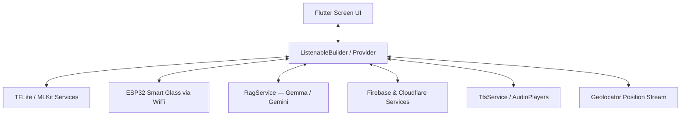

# EasyLens

EasyLens is an accessibility assistant mobile application designed for visually impaired and neurodivergent users. It operates on a fine-tuned MobileNetV2 object detection pipeline. This edge vision engine integrates local computer vision, on-device large language models (`Gemma` / `Gemini`), cloud storage, and wearable ESP32 smart glasses to function as a real-time assistant.

---

### 01 — KEY FEATURES

| Feature | Description |
|---|---|
| **Custom Object Detector** | Custom fine-tuned MobileNetV2 SSD drawing real-time bounding boxes via Dart Isolate background threads for obstacle TTS alerts. |
| **Speech Navigation** | Turn-by-turn guidance controlled via continuous speech (STT). Includes Filipino/Tagalog support, dynamic map pinning, and global arrival notifications. |
| **Buddy Local AI** | On-device Gemma-IT 2B LLM for English; Google Gemini 3.6 Flash (Low) for Filipino. Full voice I/O and RAG knowledge base. |
| **Nearby Text Scanner** | Supported by ML Kit OCR; reads text aloud; forwards to Buddy for context explanation. |
| **SOS & Emergency** | SMS dispatch to active emergency contacts via the MensaHero gateway. |
| **Voice Personas** | 6 personas (including Maya for native Tagalog) with distinct pitch/rate. Applied universally across all TTS output. |
| **Filipino Language** | Full app localization — UI strings, greetings, Buddy, Navigation, Settings — switch live. |
| **Dynamic Theming** | Default (light) and Black (AMOLED) themes with 8 accent color choices applied globally in real time. |
| **ESP32 Smart Glass** | Streams MJPEG video from a custom ESP32-CAM head-mounted device over Wi-Fi directly into the object detection pipeline. See [`SCHEMATIC.md`](hardware/SCHEMATIC.md) for full wiring and dev board schematic. |
| **Shake to Undo** | Accelerometer gesture (>2.5g) triggers undo action and TTS confirmation. |
| **Bark Sound Cue** | `bark_dashboard.mp3` plays once on welcome/startup and tab interactions. |

---

### 02 — TECH STACK & SERVICES

#### Core
- Flutter (Dart SDK `^3.11.5`) — Cross-platform mobile runtime
- `Provider` + `ListenableBuilder` — Reactive state management

#### AI / ML
- `flutter_gemma: ^0.13.6` — On-device Gemma-IT 2B (English Buddy, offline)
- `google_generative_ai: ^0.4.4` — Gemini 3.6 Flash (Low) API (Filipino Buddy)
- `google_mlkit_text_recognition: ^0.15.1` — On-device OCR (Text Scanner)
- `google_mlkit_image_labeling: ^0.14.2` — On-device image labeling
- `tflite_flutter: ^0.12.1` — MobileNetV2 SSD object detection

#### Audio & Accessibility
- `flutter_tts: ^4.2.5` — Text-to-Speech with persona support
- `speech_to_text: ^7.4.0` — Voice input for Buddy and navigation
- `audioplayers: ^6.1.0` — Sound effect cues (`bark_dashboard.mp3`, etc.)

#### Location & Sensors
- `google_maps_flutter: ^2.5.3` — Map rendering and route display
- `geolocator: ^11.0.0` — GPS position stream
- `sensors_plus: ^5.0.1` — Accelerometer (shake detection)

#### Cloud & Storage
- Firebase Auth + Firestore + Storage — Auth, profile sync, avatar storage
- Notion REST API (`NotionService`) — Direct dual sync of user feedback to Notion Database
- Cloudflare R2 — Object storage (captures, backups)
- Cloudflare D1 — Serverless SQL (relational sync)
- `shared_preferences: ^2.2.3` — Local on-device key-value store

#### Networking
- `http: ^1.2.1` — REST calls (Google Maps routing, Ollama, Geocoding, ESP32)
- `flutter_dotenv: ^5.2.1` — `.env` secrets management

#### Containerization & DevOps
- Docker & Docker Compose — Containerized web application portal & NGINX distribution
- GitHub Actions & GHCR — Automated CI/CD test, build, and container publishing

---

### 03 — ARCHITECTURE

> **Note:** For a complete breakdown of the project layout, database systems, and data flow, see the [`architecture.md`](docs/architecture/architecture.md) document.



#### Key Documents & Technical Specifications Index

| Category / Folder | Document File | Description |
|---|---|---|
| **Architecture** | [`architecture.md`](docs/architecture/architecture.md) | Comprehensive technical system architecture, `Provider` state flow, and database models. |
| | [`conceptual_framework.md`](docs/architecture/conceptual_framework.md) | Academic Conceptual Framework & Theoretical IPO Model (Input-Process-Output). |
| | [`ai_architecture.md`](docs/architecture/ai_architecture.md) | On-device Gemma-IT 2B LLM, Gemini 3.6 Flash (Low), RAG engine, and Ollama fallback. |
| | [`local_storage_architecture.md`](docs/architecture/local_storage_architecture.md) | SQLite database caching, `SharedPreferences` key-value store, and Firestore sync. |
| | [`object_detection_architecture.md`](docs/architecture/object_detection_architecture.md) | Real-time TFLite MobileNetV2 SSD pipeline, ML Kit, and Speech Navigation logic. |
| **System & UML Diagrams** | [`system_architecture_and_uml.md`](docs/system_architecture/system_architecture_and_uml.md) | Complete UML Class, Component, Sequence, and State Machine diagrams. |
| **Data Flow & Diagrams (DFD)**| [`data_flow_diagrams.md`](docs/dfd/data_flow_diagrams.md) | Current vs. Proposed Level-1 and Level-2 Data Flow Diagrams (DFD). |
| | [`use_case_diagrams.md`](docs/dfd/use_case_diagrams.md) | Simplified and Detailed Architectural Use Case Diagrams (UCD) and specifications. |
| | [`entity_relationship_diagram.md`](docs/dfd/entity_relationship_diagram.md) | Conceptual and Relational ERD models for Cloudflare D1 and local SQLite. |
| | [`data_dictionary.md`](docs/dfd/data_dictionary.md) | Database schemas, field data types, nullability, and primary/foreign key constraints. |
| | [`gantt_chart.md`](docs/dfd/gantt_chart.md) | Project implementation timeline and execution schedule (Dec 2025 – Aug 2026). |
| | [`dataset_specifications.md`](docs/dfd/dataset_specifications.md) | COCO 26-to-24 class dataset curation, ML Kit object detection comparison and support. |
| **Vision & AI Engines** | [`face_registration_and_recognition.md`](docs/vision_and_ai/face_registration_and_recognition.md) | 25-dimensional geometric landmark feature vector extraction and face recognition pipeline. |
| | [`ai_memory_and_guardrails.md`](docs/vision_and_ai/ai_memory_and_guardrails.md) | Conversational context memory windowing, system prompts, and Gemini guardrails. |
| | [`algorithm.md`](docs/vision_and_ai/algorithm.md) | Mathematical spatial hazard scoring, IoU algorithms, and bounding box math. |
| **Specifications & Quality** | [`software_and_hardware_specifications.md`](docs/specifications/software_and_hardware_specifications.md) | Hardware specifications, ESP32-CAM-MB, OV2640 70°, thermal dissipation, and device requirements. |
| | [`usability_quality_metrics.md`](docs/specifications/usability_quality_metrics.md) | Empirical ISO/IEC 25010, ISO/IEC 5055, and WCAG 2.2 AAA usability evaluation targets. |
| | [`software.md`](docs/specifications/software.md) | Full software component and technology stack table, Android APK, and iOS IPA specs. |
| **Features & Modules** | [`features.md`](docs/features_and_modules/features.md) | Screen-by-screen application feature catalog and accessibility controls. |
| | [`navigation_warning_system.md`](docs/features_and_modules/navigation_warning_system.md) | Multimodal spatial audio and tactile haptic obstacle proximity warning engine. |
| **Training & Notebooks** | [`mobilenetv2_transfer_learning_workflow.md`](docs/training/mobilenetv2_transfer_learning_workflow.md) | Multi-Phase transfer learning and unfreezing workflow flowcharts. |
| | [`mobilenetv2_finetuning_report.md`](docs/training/mobilenetv2_finetuning_report.md) | MobileNetV2 fine-tuning empirical evaluation report (>85% Top-1 / 2.48ms latency). |
| | [`hybrid_ai_fusion_app_integration.md`](docs/training/hybrid_ai_fusion_app_integration.md) | Multi-tier AI fusion architecture combining TFLite, ML Kit, and Gemma LLM. |
| | [`easylens.ipynb`](docs/training/easylens.ipynb) | Jupyter Notebook with complete 4-phase MobileNetV2 fine-tuning training code. |
| **Setup & Cloud Config** | [`security_configuration.md`](docs/setup/security_configuration.md) | Security key management, `.env` file templates, and credential isolation. |
| | [`cloudflare_r2_setup.md`](docs/setup/cloudflare_r2_setup.md) | Cloudflare R2 bucket setup, CORS policy, and AWS SigV4 signing configuration. |
| | [`cicd_pipeline.md`](docs/setup/cicd_pipeline.md) | Continuous Integration and release build pipeline specifications. |
| | [`DOCKER.md`](DOCKER.md) | Docker containerization guide, Compose orchestration, and local demo steps. |
| **Releases & Navigation** | [`releases.md`](docs/releases.md) | Official release notes and version changelog history (v1.0 - v20.0). |
| | [`readme.md`](docs/readme.md) | Documentation index map and topic directory guide. |
| **Canonical Reference** | [`readme.md`](docs/source-of-truth/readme.md) | Canonical source-of-truth technical specifications (Chapters 01 - 10). |

---

### 04 — DEVELOPER GUIDE

#### Prerequisites

> - Flutter SDK (version matching `pubspec.yaml` environment — SDK `^3.11.5`)
> - Android SDK 21+ / Xcode 14+
> - A physical Android device or emulator
> - Firebase project configured (see `google-services.json`)
> - `.env` file with required keys (see `.env.example`)

#### Environment Variables

```env
GEMINI_API_KEY=your_gemini_api_key
FIREBASE_API_KEY=...
FIREBASE_APP_ID=...
FIREBASE_MESSAGING_SENDER_ID=...
FIREBASE_PROJECT_ID=...
FIREBASE_STORAGE_BUCKET=...
GOOGLE_MAPS_KEY=your_maps_api_key
MENSAHERO_API_KEY=your_sms_gateway_key
MENSAHERO_BASE_URL=https://mensahero.onrender.com
ACCOUNT_ID=your_cloudflare_account_id
S3_API=https://<account_id>.r2.cloudflarestorage.com/<bucket>
ACCESS_KEY_ID=...
SECRET_ACCESS_KEY=...
BUCKET_NAME=easylens
```

#### Running the App

##### Physical Device (Recommended)
```bash
flutter run --target-platform android-arm64
```

##### Android Emulator

> **Note:** Because the application bundles complex native libraries (`ML Kit`, `Gemma`, `TensorFlow Lite`), debug builds compile for all ABIs by default. To avoid `Requested internal only, but not enough space` errors on the emulator:

```bash
flutter run --target-platform android-x64
```

##### Wireless ADB (Samsung Galaxy A55 / Similar)
```bash
adb connect <device-ip>:5555
flutter run
```

#### Installing the On-Device Gemma Model

The Gemma-IT 2B model (`model.bin`, ~1.3 GB) must be pushed to the device manually:

```bash
adb push model.bin /sdcard/Android/data/com.company.easylens/files/model.bin
```

Then restart the application. Buddy will automatically detect the model and use it for English queries.

#### Running Tests
```bash
flutter test
flutter analyze
```

#### ESP32 Hardware Setup

To stream live video into the object detection pipeline, you must connect your mobile device to the ESP32's local Wi-Fi Access Point:

> **Network Name (SSID):** `EasyLens-Camera`  
> **Password:** *(None / Open Network)*  

Flash the `hardware/esp32_cam_wifi_ap/esp32_cam_wifi_ap.ino` sketch to your ESP32-CAM module to initiate the MJPEG stream.

#### 🐳 Docker Container & Web Portal Deployment

EasyLens includes a production containerized NGINX web and application distribution portal. Anyone can deploy and run it locally or in cloud environments using Docker without needing Flutter, Android SDK, or Java pre-installed.

> 💻 **Cross-Platform Compatibility:** The containerized portal and CI/CD packages are built for multi-architecture support (`linux/amd64` and `linux/arm64`). Fully compatible across **Windows 10/11** (PowerShell / Command Prompt / WSL2), **macOS** (Apple Silicon M1/M2/M3/M4 & Intel), and **Linux** (Ubuntu / Debian / Arch / Fedora).
>
> For full architecture, Dockerfile breakdown, and CI/CD pipeline specifications, see [`DOCKER.md`](DOCKER.md).

##### Deployment Options Overview

| Deployment Method | Mechanism | Ideal Use Case |
|---|---|---|
| **Local Build (Docker Compose)** | Clones source repository and builds container image locally via Compose. | Local development, code modification, testing, and full local orchestration. |
| **Standalone Docker CLI** | Builds and executes the container directly using native Docker CLI commands. | Lightweight testing, custom container arguments, or environments without Compose. |
| **Pre-built Package (GHCR)** | Pulls pre-compiled multi-arch image (`linux/amd64`, `linux/arm64`) from GitHub Packages. | Production cloud hosting (AWS, GCP, DigitalOcean), CI/CD, or running without cloning source files. |

---

##### Option 1: Local Build via Docker Compose (Recommended)

1. **Clone the repository:**
   ```bash
   git clone https://github.com/Thes-IS-IT/Easylens.git
   cd Easylens
   ```

2. **Build and launch the container:**
   ```bash
   docker compose up --build -d
   ```

3. **Verify container status and health:**
   ```bash
   docker compose ps
   curl -I http://localhost:8080/
   ```

4. **Access the web portal:**
   Open `http://localhost:8080` in your web browser.

5. **Stop the container:**
   ```bash
   docker compose down
   ```

---

##### Option 2: Standalone Docker CLI (Local Build)

1. **Build the Docker image:**
   ```bash
   docker build -t easylens:latest .
   ```

2. **Run the container:**
   ```bash
   docker run -d --name easylens_app -p 8080:80 --restart always easylens:latest
   ```

3. **Verify health check and access:**
   ```bash
   curl -I http://localhost:8080/
   ```
   Open `http://localhost:8080` in your web browser.

4. **Stop and remove container:**
   ```bash
   docker stop easylens_app && docker rm easylens_app
   ```

---

##### Option 3: Pre-Built Multi-Architecture Package (GitHub Container Registry)

Run the pre-compiled container directly without cloning the repository or compiling locally:

1. **Pull and run the pre-built image:**
   ```bash
   docker run -d --name easylens_live -p 8080:80 --restart always ghcr.io/thes-is-it/easylens:latest
   ```

2. **Verify health check and access:**
   ```bash
   curl -I http://localhost:8080/
   ```
   Open `http://localhost:8080` in your web browser.

3. **Stop and remove container:**
   ```bash
   docker stop easylens_live && docker rm easylens_live
   ```

---

##### Automated Docker Test Suite

Run the automated test suite to verify all three Docker deployment modes, container healthchecks, and HTTP responses end-to-end:

```bash
chmod +x scripts/test_docker.sh
./scripts/test_docker.sh
```

---

##### Architectural Component Breakdown & Roles

To understand how Docker interacts with the codebase versus standard Git workflows, the following table and reference outlines each component's distinct role:

| Component Label | Type | Purpose | Primary Command |
|---|---|---|---|
| **Git Repository** | Source Control | Stores raw, editable code files (`.dart`, `.html`, `.conf`), version history, and configurations. | `git clone https://github.com/Thes-IS-IT/Easylens.git` |
| **Container Image** | Packaged Appliance | An immutable, multi-architecture Linux snapshot bundling NGINX, web assets, and health checks. | `docker pull ghcr.io/thes-is-it/easylens:latest` |
| **Container Instance** | Runtime Process | Active execution instance of the Docker image running on host port `8080`. | `docker run -d -p 8080:80 ghcr.io/thes-is-it/easylens:latest` |
| **Web Portal Gateway** | Distribution UI | Interactive landing interface serving Buddy assets, APK downloads, and iOS installation guides. | Access at `http://localhost:8080` |
| **Asset Extraction** | Container Utility | Copies assets or build outputs directly from inside a container to the host machine without Git. | `docker cp <container_name>:<path_inside> <host_path>` |

###### Conceptual Difference: `git clone` vs `docker pull`

- **`git clone` (Source Code Repository):**  
  Downloads individual source files, documentation, and Git branches to your local machine for editing, code development, and manual compilation.
- **`docker pull` (Pre-Packaged Appliance):**  
  Downloads a self-contained, pre-compiled application appliance from GitHub Container Registry (GHCR). It does not download individual repository files to your folder; rather, the web portal and its dependencies run inside Docker's isolated runtime engine.

###### Inspecting or Extracting Files from Container (`docker cp`)

If you need to retrieve files or assets directly from a container to your host machine without cloning the Git repository:

```bash
# 1. Start the container
docker run -d --name easylens_extract -p 8080:80 ghcr.io/thes-is-it/easylens:latest

# 2. Copy the index.html or assets to your local directory
docker cp easylens_extract:/usr/share/nginx/html/index.html ./index.html
docker cp easylens_extract:/usr/share/nginx/html/app_logo.png ./app_logo.png

# 3. Clean up the container
docker stop easylens_extract && docker rm easylens_extract
```

---

### 05 — LANGUAGE SUPPORT

| Language | Code | UI | Buddy | TTS Voice |
|---|---|---|---|---|
| English | `en` | Yes | Gemma (offline) | `en-US` persona |
| Filipino / Tagalog | `fil` | Yes | Gemini 3.6 Flash (Low) | `en-US` persona (Filipino text pronounced correctly) |

---

### 06 — PROJECT STRUCTURE (ABBREVIATED)

```text
easylens/
├── lib/
│   ├── constants/        # AppColors — dynamic theme tokens
│   ├── models/           # UserPreferences, AppNotification, EmergencyContact
│   ├── services/         # TtsService, RagService, SettingsService, Esp32Service…
│   ├── screens/
│   │   ├── dashboard/    # Home, Buddy, Navbar, Mascot Banner
│   │   ├── navigation/   # GPS turn-by-turn with proximity TTS
│   │   ├── hardware/     # ESP32 camera + ML Kit live feed
│   │   ├── settings/     # Full settings panel + Voice Feedback screen
│   │   ├── emergency/    # SOS dispatch
│   │   ├── contacts/     # Emergency contact management
│   │   ├── notifications/ # In-app notification log
│   │   ├── signup/       # 8-step onboarding wizard
│   │   └── object_detection/ # TFLite bounding box screen
│   └── utils/            # AppRoute (declarative navigation)
├── hardware/
│   ├── esp32_cam_wifi_ap/ # ESP32-CAM MJPEG streamer firmware (.ino)
│   └── SCHEMATIC.md      # Pinout, dev board integration & wiring schematic
├── assets/
│   ├── mascots/          # Buddy mascot images (idle, thinking, listening…)
│   ├── models/           # TFLite model files
│   ├── images/           # App images
│   └── sounds/           # bark_dashboard.mp3 and other audio cues
├── docs/                 # Full technical documentation
└── .env                  # API keys and secrets (never commit)
```

---

### 07 — SECURITY

- All API keys stored in `.env` (excluded from git via `.gitignore`)
- Cloudflare R2 uploads use client-side **AWS Signature Version 4** (HMAC-SHA256) — no secrets transmitted in plaintext
- Firebase Security Rules enforce per-user read/write isolation
- Gemma runs fully **on-device** for English — no user query data leaves the device
- For complete security policies, threat models, and vulnerability reporting procedures, see [`SECURITY.md`](SECURITY.md).

---

### 08 — LICENSE

EasyLens is licensed under a **Modified MIT License with Academic Thesis Conditions**. It permits academic study, research, and non-commercial educational review, but requires explicit prior written permission for commercial use and strictly prohibits academic plagiarism. See the [`LICENSE.md`](LICENSE.md) file for full details and third-party license notices.

```text
Copyright (c) 2026 Graciella Mhervie D. Jimenez, Jian Kalel D. Marquez,
Arron Kian M. Parejas, Jenica Sarah B. Tongol
Holy Angel University — School of Computing
```

---

### 09 — RESEARCH TEAM & THESIS

EasyLens was conceptualized, researched, and engineered as an undergraduate thesis project at **Holy Angel University (HAU)**, Angeles City, Pampanga, Philippines by the **Thes-IS-IT** research team:

| Researcher / Author | Role / Area of Focus |
|---|---|
| **Graciella Mhervie D. Jimenez** | Project Manager, Lead UI/UX Systems Designer, and Usability Testing Coordinator |
| **Jian Kalel D. Marquez** | Lead Hardware Systems Engineer, Quality Assurance Specialist, and Field Testing Assistant |
| **Arron Kian M. Parejas** | Lead Software Architect and Artificial Intelligence / Machine Learning Engineer |
| **Jenica Sarah B. Tongol** | Lead Quality Analyst, and Technical Documentation Specialist |

- **Institution:** Holy Angel University (HAU)
- **College:** School of Computing
- **Course:** Computer Science
- **Organization / Repository:** [Thes-IS-IT/Easylens](https://github.com/Thes-IS-IT/Easylens)

---

### 10 — CONTRIBUTING

We welcome community contributions, academic collaborations, and feature enhancements. Please read our [`CONTRIBUTING.md`](CONTRIBUTING.md) guide for coding conventions, test requirements, and pull request procedures.
