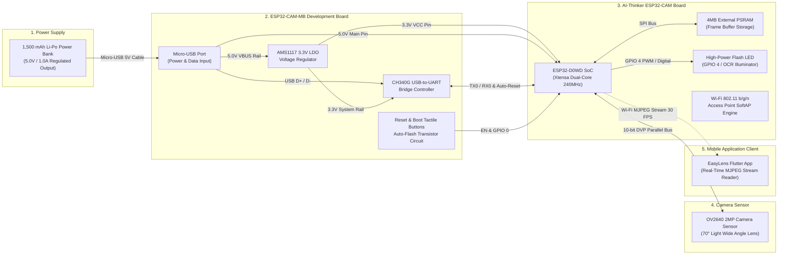
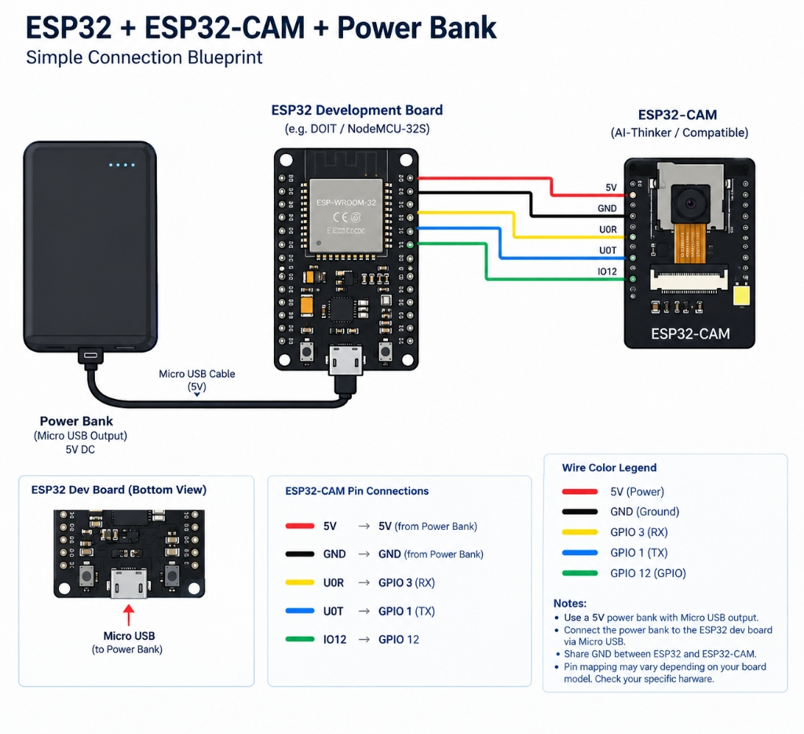
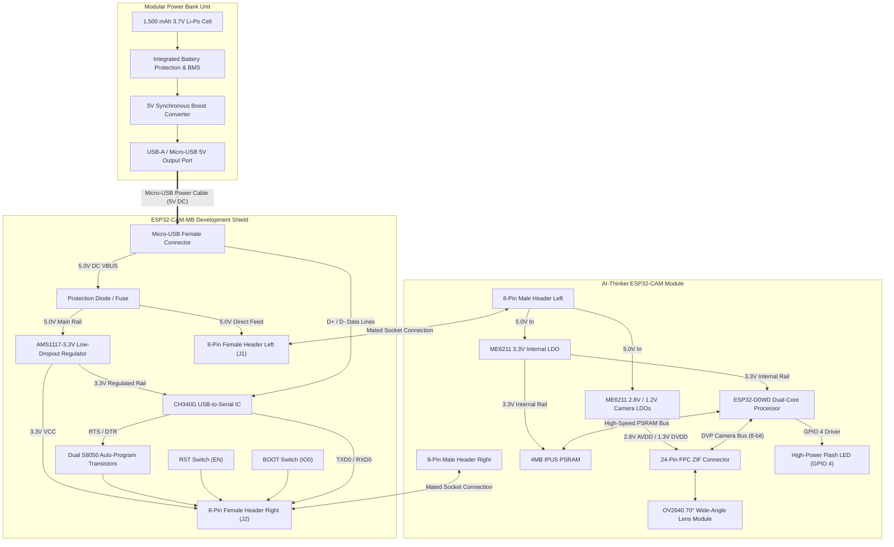

# EasyLens ESP32-CAM & Development Board Schematic

This document provides the complete hardware wiring, pinout mapping, and electrical schematic diagram for the **EasyLens Smart Glass Edge Vision Module**. It details the integration of the **AI-Thinker ESP32-CAM**, the **ESP32-CAM-MB Development Baseboard (CH340G)**, the **OV2640 70° Camera**, and the **1,500 mAh Micro-USB Power Bank**.

---

## 1. High-Level System Architecture



---

## 2. Visual Connection Blueprint



### Wire Color Legend & Pin Interconnections

| Wire Color | Signal / Rail | ESP32 Development Board | ESP32-CAM Pin | Functional Description |
| :---: | :--- | :--- | :--- | :--- |
| 🔴 **Red** | **5V (Power)** | `5V` (from Power Bank VBUS) | `5V` Pin | Primary 5.0V DC regulated supply rail |
| ⚫ **Black** | **GND (Ground)**| `GND` (from Power Bank) | `GND` Pin | Common system ground reference |
| 🟡 **Yellow** | **UART RX** | `GPIO 3` (RX0) | `U0R` (IO3) | Serial receive data communication line |
| 🔵 **Blue** | **UART TX** | `GPIO 1` (TX0) | `U0T` (IO1) | Serial transmit data communication line |
| 🟢 **Green** | **GPIO** | `GPIO 12` | `IO12` | Digital control line / strapping pin |

> 📌 **Engineering Notes**:
> - **Power Supply**: Always use a regulated 5.0V power bank with a Micro-USB cable connected directly into the development board.
> - **Common Ground (GND)**: Ground must be shared between the ESP32 development board and the ESP32-CAM to prevent floating voltage references and sensor brownout.
> - **Modular Socket Mating**: When using the dedicated **ESP32-CAM-MB** shield, the ESP32-CAM plugs directly into female sockets, routing these exact 5V, GND, TX, RX, and GPIO pins without external jumper cables.

---

## 3. Component Interconnect & Power Delivery Network (PDN)



---

## 4. Detailed Pin-to-Pin Interface Mapping

The **ESP32-CAM-MB** baseboard mates with the **ESP32-CAM** board via dual 8-pin inline headers (16 pins total).

### 4.1 Left Header Interface (J1 / 8 Pins)

| Pin # | Header Label | Signal Type | Electrical Function | Connected Destination |
| :---: | :--- | :--- | :--- | :--- |
| **1** | **5V** | Power (Input) | Primary 5.0V DC supply rail from Micro-USB VBUS | Powers internal 3.3V and 2.8V LDO regulators |
| **2** | **GND** | Ground | Common system electrical reference | Power Bank & Development Board Ground plane |
| **3** | **IO12** | Digital I/O | SD Data 2 / General Purpose I/O | Internal Pull-Up (Boot strap caution) |
| **4** | **IO13** | Digital I/O | SD Data 3 / General Purpose I/O | Available for external sensors |
| **5** | **IO15** | Digital I/O | SD Command / General Purpose I/O | Internal Pull-Up |
| **6** | **IO14** | Digital I/O | SD Clock (CLK) | High-speed clock line |
| **7** | **IO2** | Digital I/O | SD Data 0 / Onboard Status LED | Blue activity indicator LED |
| **8** | **IO4** | Digital Out | High-brightness Flashlight LED driver | Controls N-MOSFET for front illumination |

### 4.2 Right Header Interface (J2 / 8 Pins)

| Pin # | Header Label | Signal Type | Electrical Function | Connected Destination |
| :---: | :--- | :--- | :--- | :--- |
| **9** | **3V3** | Power (Output/Input) | 3.3V Regulated Voltage Rail | Output from AMS1117-3.3V LDO |
| **10** | **IO16** | Digital I/O | U2RXD / PSRAM Chip Select | Dedicated to 4MB PSRAM timing bus |
| **11** | **IO0** | Digital I/O (Boot) | Boot Mode Select / Camera XCLK | Pulled LOW by CH340G auto-reset circuit during flash |
| **12** | **GND** | Ground | Secondary Ground return pin | Star-ground topology to eliminate noise |
| **13** | **VCC** | Power (Configurable) | Auxiliary 3.3V / 5V jumper output | Reserved / Connected to 3.3V rail |
| **14** | **U0R (IO3)** | Serial RX | UART0 Receive line | Connected to CH340G TXD (Pin 2) |
| **15** | **U0T (IO1)** | Serial TX | UART0 Transmit line | Connected to CH340G RXD (Pin 3) |
| **16** | **GND / RST**| Reset / Ground | External Reset trigger (EN) | Pulled LOW by RST button / DTR auto-reset |

---

## 5. OV2640 Camera Sensor DVP Pinout (24-Pin FPC)

The **OV2640 70° Light Wide Angle** sensor communicates with the ESP32-D0WD processor over a dedicated 8-bit Digital Video Port (DVP) bus and SCCB (I2C-compatible) configuration bus:

| Camera Pin Function | ESP32 GPIO | Description | Direction |
| :--- | :---: | :--- | :---: |
| **PWDN** | `GPIO 32` | Camera Power-Down control (Active HIGH) | Output from ESP32 |
| **RESET** | `-1` (N/C) | Hardware Reset (internally pulled up) | N/A |
| **XCLK** | `GPIO 0` | Master Reference Clock ($20\text{ MHz}$) | Output from ESP32 |
| **SIOC** | `GPIO 27` | SCCB / I2C Clock ($100\text{ kHz}$) | Output from ESP32 |
| **SIOD** | `GPIO 26` | SCCB / I2C Data line with internal pull-up | Bidirectional |
| **Y9 (D7)** | `GPIO 35` | Parallel Pixel Data Bit 7 (MSB) | Input to ESP32 |
| **Y8 (D6)** | `GPIO 34` | Parallel Pixel Data Bit 6 | Input to ESP32 |
| **Y7 (D5)** | `GPIO 39` | Parallel Pixel Data Bit 5 | Input to ESP32 |
| **Y6 (D4)** | `GPIO 36` | Parallel Pixel Data Bit 4 | Input to ESP32 |
| **Y5 (D3)** | `GPIO 21` | Parallel Pixel Data Bit 3 | Input to ESP32 |
| **Y4 (D2)** | `GPIO 19` | Parallel Pixel Data Bit 2 | Input to ESP32 |
| **Y3 (D1)** | `GPIO 18` | Parallel Pixel Data Bit 1 | Input to ESP32 |
| **Y2 (D0)** | `GPIO 5` | Parallel Pixel Data Bit 0 (LSB) | Input to ESP32 |
| **VSYNC** | `GPIO 25` | Vertical Frame Synchronization | Input to ESP32 |
| **HREF** | `GPIO 23` | Horizontal Line Reference | Input to ESP32 |
| **PCLK** | `GPIO 22` | Pixel Byte Clock | Input to ESP32 |

---

## 6. Power Bank & Wearable Power Distribution

### 6.1 Power Chain
1. **Source**: 1,500 mAh (3.7V / 5.55 Wh) Lithium-Polymer wearable battery pack.
2. **Regulation**: Internal boost converter delivers a stable **5.0V DC ($\pm 5\%$) @ up to 1.0A**.
3. **Cable**: Short ($15\text{ cm}$) high-gauge shielded USB cable with a 90° right-angle Micro-USB connector to prevent snagging during pedestrian head rotation.
4. **Input Point**: Micro-USB female port on the **ESP32-CAM-MB** daughterboard.
5. **On-Board Step-Down**:
   - The MB baseboard converts 5.0V to 3.3V via the **AMS1117-3.3** regulator.
   - The ESP32-CAM module receives 5.0V directly on Pin 1 and steps it down via high-efficiency low-noise **ME6211** LDOs to 3.3V (digital logic), 2.8V (analog sensor), and 1.3V (sensor core logic).

### 6.2 Electrical Power Budget

| Operational State | Current Draw @ 5.0V | Power Consumption | Expected Battery Life (1,500 mAh) |
| :--- | :---: | :---: | :---: |
| **Idle / SoftAP Listening** | $80 - 110\text{ mA}$ | $\approx 0.48\text{ W}$ | $\approx 12.0\text{ Hours}$ |
| **Continuous VGA Streaming (30 FPS)** | $240 - 290\text{ mA}$ | $\approx 1.32\text{ W}$ | $\approx 4.40\text{ Hours}$ |
| **High-Stress Mode (Stream + LED Torch)** | $380 - 450\text{ mA}$ | $\approx 2.10\text{ W}$ | $\approx 2.75\text{ Hours}$ |

---

## 7. Physical Assembly & 3D Enclosure Mounting

```text
       +-------------------------------------------------------------+
       |                  3D-PRINTED PLA HOUSING                     |
       |                                                             |
       |   +-----------------------+     +-----------------------+   |
       |   |      ESP32-CAM        |     |     ESP32-CAM-MB      |   |
       |   |                       |     |                       |   |
       |   | [OV2640 70° Lens]     | <== | [CH340G Serial IC]    |   |
       |   | [Al Heatsink Pad]     |     | [RST & BOOT Buttons]  |   |
       |   | [Flash LED GPIO 4]    |     | [Micro-USB Port]      |   |
       |   +-----------------------+     +-----------|-----------+   |
       |              || Mated Pin Headers           |               |
       +--------------||-----------------------------|---------------+
                      ||                             | [Micro-USB 5V Cable]
                      \/                             \/
           [Right Temple Eyewear Arm]     [1,500 mAh Power Bank]
```

1. **Stack Assembly**: The ESP32-CAM is pressed directly into the dual female header sockets of the ESP32-CAM-MB board.
2. **Thermal Dissipation**: An aluminum heatsink pad ($14 \times 14 \times 6\text{ mm}$) is affixed on top of the ESP32 RF shield / SoC with high-conductivity thermal adhesive.
3. **Enclosure Integration**: The stacked assembly slides into the custom 3D-printed PLA box frame with precision cutouts for:
   - Front aperture for the OV2640 70° wide-angle lens.
   - Side aperture for passive air convection over the heatsink.
   - Rear access cutout for the Micro-USB power cable.
4. **Eyewear Clamping**: Dual 2.5 mm industrial nylon zip-ties lock the enclosure onto the right temple arm of standard Wayfarer eyewear frames without modifying prescription lenses.
